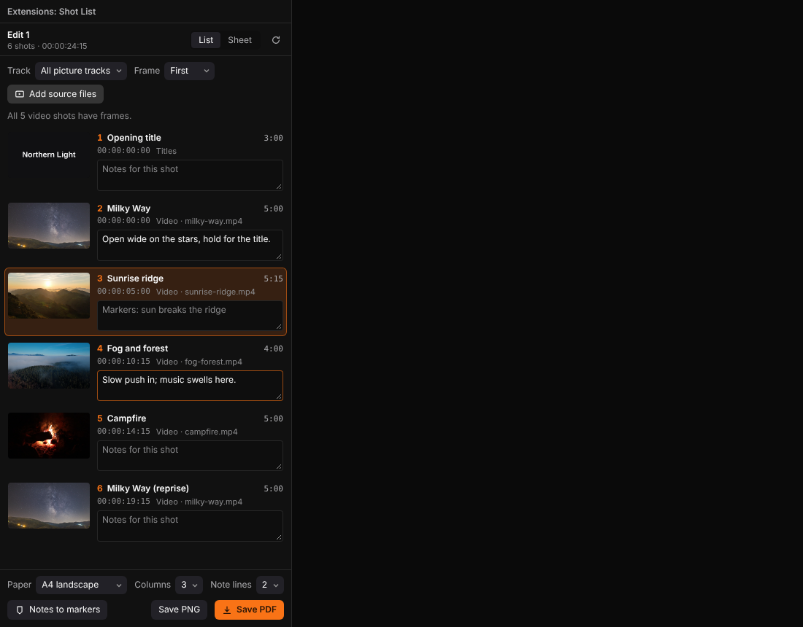
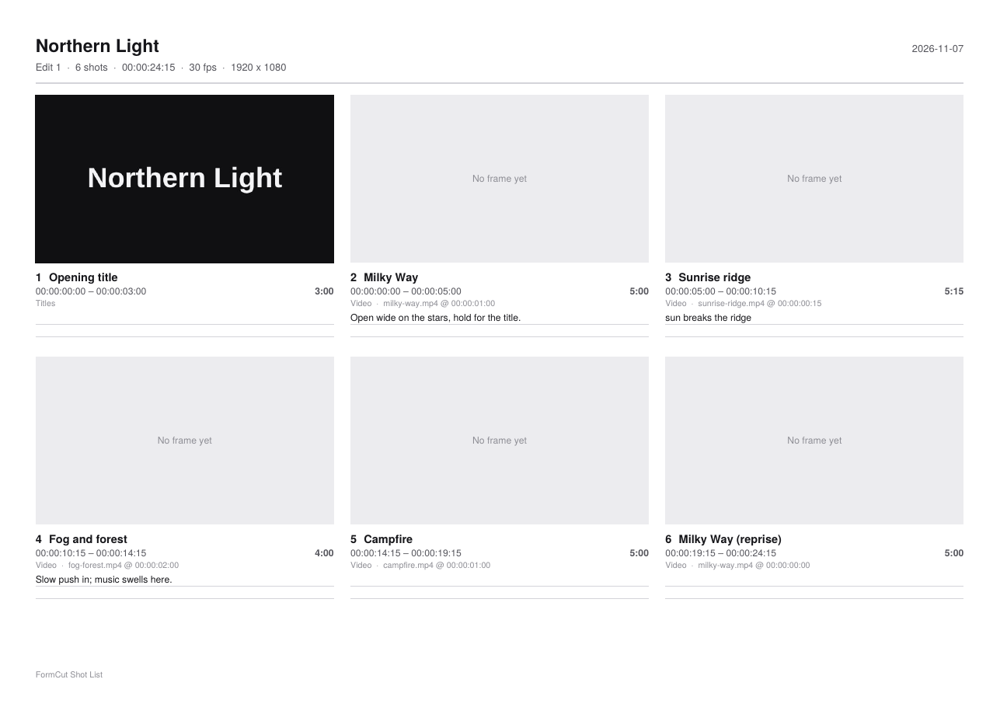

# Shot List for FormCut

A shot list and storyboard sheet for the timeline you are cutting. Shot List reads FormCut's active timeline and lists
every picture clip (video, images, titles, nested timelines) as a numbered shot with its timecodes, duration, track
and source. Add the source files and it takes a frame for each shot; write a note under any shot; then save the whole
thing as a printable PDF or as one PNG sheet to hand to a director, a client or a colourist.





## What it does

- **Shots in timeline order.** One row per picture clip of the active timeline, top track first where two start
  together; a Track menu narrows it to one track. Audio clips are left out.
- **A frame per shot.** Add source files picks the clips' media through FormCut's file dialog; Shot List matches them
  to clips by file name and decodes them inside its own sandbox, taking the first, middle or last frame of each shot.
  Titles draw their own card. Long work shows progress and can be cancelled.
- **Notes.** A note field under each shot, kept per project and timeline. Notes on markers inside a shot are shown
  and printed with it.
- **The sheet.** The Sheet tab previews the pages exactly as they will be saved. Save PDF writes A4 or Letter pages,
  landscape or portrait, two to five columns, with zero to four ruled note lines per shot and real, selectable text.
  Save PNG writes one continuous sheet.
- **Notes to markers.** Puts each shot's note on the timeline as a marker (`Shot 3: ...`) in one step, so one Undo
  takes them all back. Pressing it again adds nothing new.
- **Find a shot.** Click a shot's frame to select the clip and move the playhead to it.
- **Extensions > Shot List: Save Shot List as PDF** saves the sheet without opening the panel (frames come from titles
  only in that case, since no source files are picked).

## Install

1. Open FormPortal, find **Shot List** under FormCut's extensions, and install it. FormPortal unpacks it and tells
   FormCut, which picks it up within two seconds.
2. In FormCut, open the Extensions tab of the left pane (or Extensions > Extensions Panel) and press Open on Shot List.
3. The first time, FormCut asks for the permissions below; choose Allow.

To install a downloaded `shot-list-0.1.0.formpkg` by hand, use FormPortal's Install from File.

## Permissions

| Permission | Why |
|---|---|
| `document` | Read the active timeline (clips, markers, selection), add markers for Notes to markers, select a clip and seek to it. |
| `files-read` | Open the source files you pick, to take frames from them. They are read only inside the extension and not stored. |
| `files-write` | Save the PDF or PNG where you choose. |

No network access is asked for or used.

## Build

Requires Node 18 or newer and Python 3.

```sh
npm install
npm run build      # type-check, bundle src/ into package/ui/shot-list.js
npm run package    # dist/shot-list-0.1.0.formpkg (deterministic)
python3 tools/formpkg.py validate package
```

To run it from this folder in FormCut while you work on it, add the `package/` folder to
`extensions/formcut/dev.json` under FormPortal's root (form.ext's Run in App does this), then use
Extensions > Reload Extensions after each build.

## Limits

- Frames are taken from the source files, not from FormCut's render, so grades, effects and composited titles over
  a shot are not in its frame. Sources the window cannot decode (for example ProRes) are named; an MP4 (H.264) or
  WebM copy works.
- The PDF uses the standard Helvetica fonts; characters outside Western European Latin print as `?` there (the PNG
  shows them).

## Licence

Apache-2.0, see `LICENSE`, `NOTICE.md` and `CREDITS.md`.
