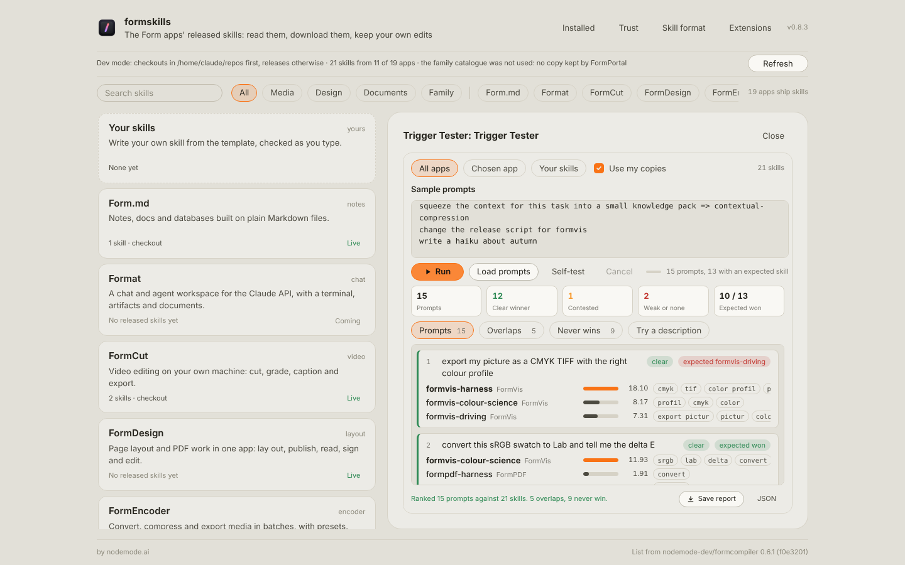

# Trigger Tester

A FormSkills extension that tells you which skill an agent would pick for a prompt, before an agent ever sees it.

Paste sample prompts, or load them from a file, and Trigger Tester ranks every skill in scope against each one with an offline BM25 model of the skills' names and descriptions, the part of a skill an agent reads when it chooses. It then shows:

- **Prompts**: the winner, runner-up and third place for each prompt, the words that matched, and a verdict: clear, contested (the runner-up is within 80% of the winner), weak (one lucky word) or no match. End a line with `=> skill-name` and it also says whether the skill you expected won.
- **Overlaps**: pairs of skills that fight for the same prompts, and pairs whose descriptions read alike even before you test them, with the words they share.
- **Never wins**: skills that win none of your prompts, where they came closest, and the words only they use.
- **Try a description**: rewrite one skill's description and watch every prompt's ranking change as you type. Save it to your copy of the skill (or to your own skill) in one step that formskills' Undo reverts, and formskills' Check runs on the result.

Save the whole report as Markdown or JSON. Click any skill name to open it in formskills.



## Scope

- **All apps**: every released skill in the library, plus your own skills.
- **Chosen app**: only the app chosen in formskills, following your choice as it changes.
- **Your skills**: only the skills you wrote.

With **Use my copies** on, a skill you have edited is ranked by the description in your copy. Word weights follow the scope, so a word every FormVis skill uses counts for little when only FormVis skills compete.

**Self-test** writes one prompt per skill from the first sentence of its description and expects that skill to win. A skill that loses its own self-test has a description another skill covers better.

## Prompt files

`Load prompts` reads `.txt` or `.md` (one prompt per line, bullets and `#` lines skipped), `.csv` (prompt, expected skill), `.json` (an array of strings or of `{ "prompt", "expect" }`, or `{ "prompts": [...] }`) and `.jsonl`.

## For agents

The headless command `rank` answers with the JSON report:

```sh
./formskills cli extensions command trigger-tester rank '{"prompts":["export a CMYK TIFF", {"text":"clean up a podcast","expect":"formwav-harness"}],"scope":"all"}'
```

Without `prompts` it uses the prompts saved in the panel.

## Install

Through FormPortal: open FormPortal, find Trigger Tester under FormSkills extensions and install it. FormPortal lists it in `extensions/formskills/enabled.json`, and formskills shows it in its Extensions menu (the Extensions button in the header) within two seconds. From a file, side-load `trigger-tester-0.1.0.formpkg` in FormPortal. Needs formskills 0.9.0 or newer.

To run it from this folder while you work on it, use form.ext's Run in App, or write `extensions/formskills/dev.json` under FormPortal's root with this repository's `package/` folder as `path`.

## Permissions

| Permission | Why |
|---|---|
| `document` | read the library, your copies and your own skills, open a skill when you click it, and save a tried description to your copy |
| `files-read` | load prompts from a file you choose |
| `files-write` | save the report where you choose |

No network: the model runs entirely inside the extension's sandbox. Released skills are never changed.

## Build

```sh
npm install
npm run build      # type-check and bundle src/ into package/ui/trigger.js
npm run package    # dist/trigger-tester-0.1.0.formpkg
python3 tools/formpkg.py validate package
```

## Licence

Apache-2.0. See `LICENSE` and `NOTICE.md`.
