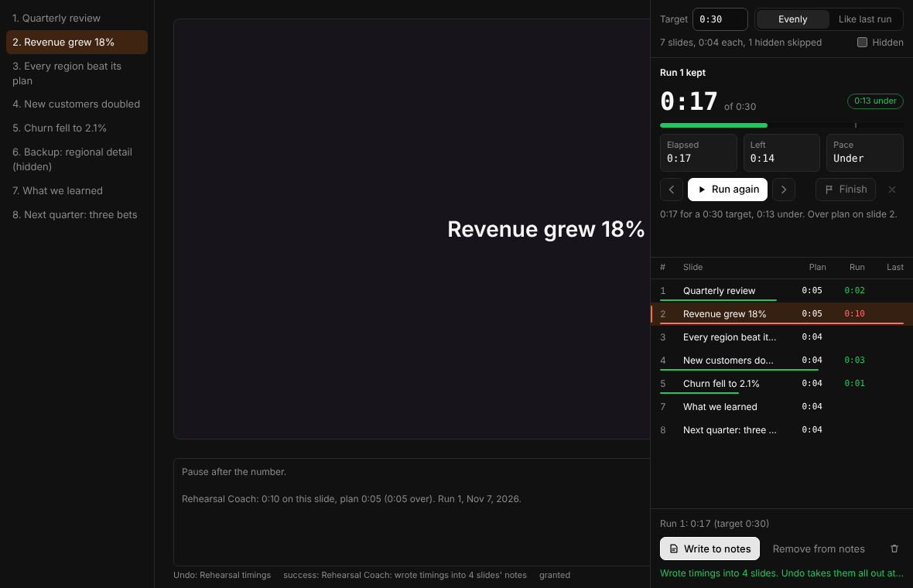

# Rehearsal Coach

A FormDeck extension that coaches the timing of your talk. Set how long the talk should be, run through the deck in the editor with your notes in view, and see every slide against its share of the target and against your last runs. When a run is kept, one click puts each slide's time into its speaker notes, so it is there in the presenter view, the notes pages and the exported file.



## What it does

- **Plan.** Type a target (`12`, `12:30`, `1:05:00` or `45m`). The target is split evenly across the slides, or in the shape of your last run. Type a time into any slide's Plan cell to set that slide yourself (it turns accent coloured); clear it to share the target again. Hidden slides are left out unless you tick Hidden.
- **Run.** Start shows the first slide in FormDeck and starts the clock. Next and Back (or Space, Right Arrow and Left Arrow while the panel has focus) move FormDeck to the slide; changing slides in FormDeck itself, from the thumbnails or the keyboard, is followed too, so the time always goes to the slide on screen. Pause (P) stops the clock; Esc cancels the run; Finish (or Enter) keeps it.
- **Live.** The slide clock against its plan, with a chip that says on time, how far over or under; elapsed and left time for the whole talk; the pace against the plan (ahead or behind); and a bar under each slide's row.
- **Review.** The total against the target, the slides that ran over, the last run's total, and a Last column with the previous run's time per slide. The last five runs per deck are kept.
- **Write to notes.** Adds or replaces one line in each timed slide's notes, such as `Rehearsal Coach: 0:42 on this slide, plan 0:35 (0:07 over). Run 3, 7 Nov 2026.` The rest of the notes is left exactly as it was, and the whole change is one undo step ("Rehearsal timings"). Remove from notes takes the lines out again, also in one step.

It works with FormDeck's own Rehearse Timings and Speech Rehearsal rather than replacing them: those run in the full-screen show and set automatic advance timings; Rehearsal Coach plans against a target in the editor and keeps the timings as notes.

## Install

- **Through FormPortal.** Find Rehearsal Coach among FormDeck's extensions in FormPortal and install it, or give FormPortal the `rehearsal-coach-0.1.0.formpkg` file to install. FormDeck picks it up within two seconds. In FormDeck choose Extensions > Rehearsal Coach: Open Rehearsal Coach, or open it from the Extensions panel, and allow it to read and change the open deck when asked.
- **From this folder (development).** Use form.ext's Run in App, or list `package/` in `extensions/formdeck/dev.json` under FormPortal's root (see FormDeck's `docs/EXTENSIONS.md`), then Extensions > Reload Extensions.

Needs FormDeck 0.32.0 or later.

## Build

```sh
npm install
npm run build      # type check, bundle src/ into package/ui/
npm run package    # dist/rehearsal-coach-0.1.0.formpkg, with its SHA-256 and size
python3 tools/formpkg.py validate package
```

## Permissions

| Permission | Why |
| --- | --- |
| `document` | read the slide titles, hidden flags and notes; show a slide with FormDeck's `go-to-slide`; write the timing lines into the notes |

No files, no network. Plans and runs are kept in the extension's own storage in FormDeck, per deck.

## Licence

Apache-2.0. See `LICENSE` and `NOTICE.md`.
