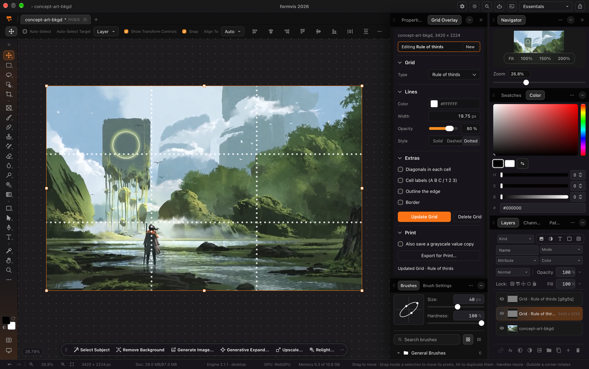

# Grid Overlay for FormVis

A FormVis extension that lays drawing grids over your art, the way painters grid a reference before copying it onto a canvas. Each grid is its own layer you can select and change later, and Export for Print saves a print-ready copy at the right physical size.



## What it does

- **Grid types**: Rule of thirds (the default), Square grid, Golden ratio, Triangular / isometric, and Radial / center lines with spokes and rings.
- **Size by cell count or by print size**: columns and rows (or square cells), or a print width and a cell size in inches or centimeters. The panel shows what that prints as, for example "Prints 16 x 10.4 in, 214 ppi". Center the grid spreads the leftover space evenly.
- **Lines**: color, width in pixels, opacity, and Solid, Dashed or Dotted. Major / minor lines draw every Nth line heavier, like graph paper.
- **Extras, all off by default**: diagonals in each cell, A B C / 1 2 3 cell labels, an edge outline, and a border band in its own color and width. Labels move into the border when it is wide enough.
- **Grids you can edit**: every grid is a layer named after it, with a short id that ties it to its settings (`Grid · Square grid, 6 × 4 [g7k2]`). Select that layer and the panel loads its settings; Update Grid redraws it in place, keeping its position in the stack, visibility, opacity and blend. Delete Grid removes it. New adds another grid instead. Several grids can share a document.
- **Export for Print**: saves the flattened picture as PNG with the print resolution written into the file, so printing at 100% gives the size you set. It can also save a grayscale copy for judging values.
- **Add Grid Overlay** (Extensions menu, palette and agents): adds a grid with your last settings without opening the panel.

Every change to the document is one step in History, so one Undo takes it back. The panel follows FormVis's theme and sizes itself to its content.

## Install

In FormPortal, open Extensions, choose FormVis and install Grid Overlay; or use Install from File with `grid-overlay-0.1.1.formpkg`. It needs FormVis 2.1.1 or later. Open it from Extensions > Grid Overlay: Grid Overlay Settings. The first time, FormVis asks you to allow it.

To run it from this folder while you work on it, form.ext's Run in App (or `extensions/formvis/dev.json` in FormPortal's folder) can point at `package/`.

## Permissions

| Permission | Why |
|---|---|
| `document` | to read the open picture's size, resolution and layers, to place, update, select, move and delete the grid layers, and to read the flattened picture for Export for Print |
| `files-write` | to save the print PNG (and the grayscale copy) where you choose |

It never opens files or reaches the network. Its settings, and each grid's settings, are kept in the extension's own storage on this computer.

## Limits

- Export for Print uses the flattened picture FormVis hands over, which is at most 4096 pixels on its long side; the resolution written into the file allows for that, so the print size stays right.
- Grids on documents over about 16 million pixels are placed as SVG instead of PNG, so FormVis draws them.

## Build

```sh
npm ci
npm run build      # copies src/ and vendor/formext.js into package/ui, byte for byte
```

The extension is plain ES modules with no dependencies. `vendor/formext.js` is the Form Extension SDK client from form.ext, kept unchanged.

## Licence

Apache License 2.0. See `LICENSE`.
